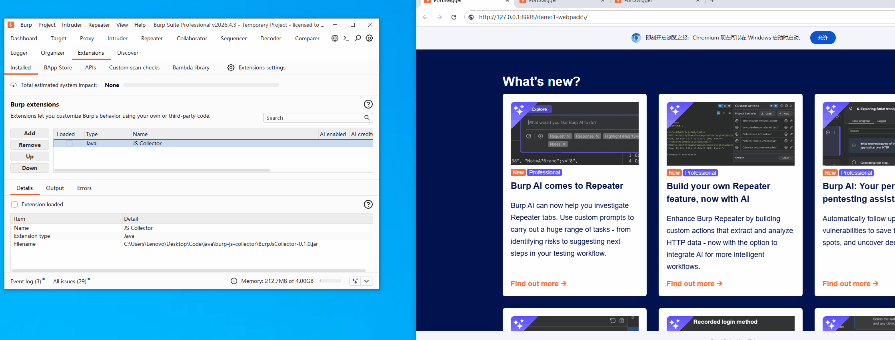

# JS Collector

<p align="center">
  <a href="https://github.com/0xLatentThreat/burp-js-collector/releases"></a>
  <a href="https://portswigger.net/burp/extender/api"></a>
  <a href="https://openjdk.org/projects/jdk/17/"></a>
  <a href="LICENSE"></a>
  <a href="README_CN.md"></a>
</p>

---

## 🎬 Real-World Demonstration

> ⚡ **Quick Take**: Stop extracting barren, parameter-less URLs from minified JS. Load the extension, browse the target normally, and watch JS Collector automatically fetch hidden lazy chunks, extract full parameter trees, and catch backend SQL syntax errors upon live probing!

<p align="center">
  
</p>

---

## 💡 Why JS Collector?

In modern web penetration testing and Bug Bounty engagements, client-side JavaScript is a primary goldmine for uncovering unauthorized endpoints, broken access control (IDOR), and hardcoded cloud credentials.

However, existing community tools (such as JSFinder, LinkFinder, and JS-Miner) suffer from two fatal limitations:
1. **Barren "Bare URLs" Only**: Traditional regular expressions only pull raw path strings. When an endpoint like `/api/v1/user/update` is found, security researchers still have no idea what parameter names, data structures, or default values it expects, requiring hours of tedious manual de-obfuscation.
2. **Modern SPA Code-Splitting Blind Spots (> 60% missed)**: Modern bundlers (Webpack 4/5, Vite, Rollup) aggressively split code into lazy-loaded chunks. During normal browsing, the browser only loads landing page scripts — **sensitive administrative, checkout, and approval modules are never requested by the browser**, creating massive blind spots.

**JS Collector bridges this gap**:
Built on Burp Suite's modern **Montoya API**, it passively listens to proxy traffic, **dynamically resolves Webpack 4/5 runtime chunk maps to recursively fetch chunks the browser never touched**, and uses cross-file AST static analysis to **reconstruct complete parameter names, literal default values, Vuex/Pinia dispatch actions, and exact source evidence**.

---

## ⚡ Capability Comparison

| Capability | JS Collector | JS Miner | JS Link Finder | HaE | Burp Scanner (Pro) |
|---|:---:|:---:|:---:|:---:|:---:|
| **Montoya API Native** | ✅ | ❌ (Legacy Extender) | ❌ (Legacy Extender) | ❌ | Built-in |
| **Recursive Lazy Chunk Discovery** | ✅ (Webpack 4/5) | ❌ | ❌ | ❌ | ❌ |
| **True Parameter Recovery** | ✅ (Fields & Defaults) | ❌ (URLs only) | ❌ (URLs only) | ❌ | Partial |
| **Vuex / Pinia Action Mapping** | ✅ (Multi-hop dispatch) | ❌ | ❌ | ❌ | ❌ |
| **Modern Protocols (WS / SSE / Beacon / Upload)** | ✅ (Full suite) | ❌ | ❌ | ❌ | ❌ |
| **Target Scope Enforcement** | ✅ (Zero-config + toggle) | ❌ | ❌ | ❌ | Built-in |
| **Adaptive Dark & Light Theme** | ✅ (Pixel-perfect) | Partial bugs | ❌ | Partial bugs | Built-in |
| **Passive Risk & Live SQL Error Detection** | ✅ (SQL errors/Secrets/Deser) | ✅ (Secrets only) | ❌ | ✅ | Partial |

---

## 🌟 Key Innovations

### 1. Auto-Discovery of Unrequested Chunks
Modern single-page applications split features into asynchronous chunks (`import('./admin.vue')`). JS Collector reverses runtime chunk maps (`__webpack_require__.u`, `jsonpScriptSrc`) and parses HTML `<link rel="modulepreload">` tags to automatically download hidden, high-privilege feature bundles that standard visitors never trigger.

### 2. True Parameter Recovery
Instead of empty URLs, JS Collector reconstructs actionable call definitions:
- Query parameters & request body fields: `{ page: 1, pageSize: 50, role: "ROLE_ADMIN", sortField: "id" }`
- RESTful template literal variables: `/api/v2/crm/lead/{leadId}/timeline`
- Popular HTTP client wrappers: `request.post()`, `client.get()`, `http.delete()`, `api.put()`
- Literal default values: `taxRate: 0.13`, `amount: 99.50`

### 3. Live SQL Error Discovery via "Probe Alive"
Select any discovered endpoint in the **Endpoints** tab and choose **Probe alive**. If the backend server throws an unhandled database exception (MySQL `SQL syntax`, `SQLException`, Oracle `ORA-`, PostgreSQL `syntax error`), JS Collector instantly flags a **HIGH-severity `SQL_ERROR` alert** in the **Findings** tab with exact response evidence, highlighting potential injection flaws cleanly and safely.

### 4. Passive Secret, PII & Deserialization Audit
Passively audits all collected JavaScript bodies and probe responses against a fine-tuned rule engine:
- **Cloud & Service Credentials**: AWS Access Keys (`AKIA...`), GitHub Personal Access Tokens (`ghp_...`), Slack Webhooks;
- **Private Keys & Databases**: RSA/EC Private Key headers, internal JDBC connection strings (`jdbc:mysql://...`);
- **Serialization Signatures**: Java serialization magic bytes (`ac ed 00 05`), PHP serialized strings (`O:8:"UserAuth"...`);
- **IDOR Heuristics**: Automatically tags endpoints possessing object identifiers (`userId`, `orderNo`, `accountId`) as potential IDOR candidates.

---

## 🚀 Quick Start & Installation

### Requirements
- **Burp Suite**: Professional or Community Edition (2024.1+ / 2025.10+ recommended).
- **Java**: Java 17 or higher (Burp Suite's bundled JRE works out of the box).

### 1-Minute Install
1. Download the latest pre-compiled **`BurpJsCollector-0.1.0.jar`** from [Releases](https://github.com).
2. In Burp Suite: navigate to **Extensions** → **Installed** → **Add**.
3. Select **Extension type**: `Java`, choose `BurpJsCollector-0.1.0.jar`, and click **Next**.
4. The **JS Collector** tab will appear in your top navigation bar.
5. **Zero Configuration**: Simply browse your target in Burp's embedded browser. Discovered JS files, unrequested chunks, and structured endpoints will stream into the UI automatically!

---

## 🛡️ Enterprise Stability & Safety

Engineered to satisfy PortSwigger BApp Store inclusion requirements:
- **Scope Control**: Works out-of-the-box on passive proxy traffic; an **Only in-scope** checkbox is always available for strict traffic isolation. Chunk auto-fetching is strictly restricted to the **Same Origin**, never probing external domains.
- **5MB OOM Circuit Breaker**: Safely handles multi-megabyte bundles with streaming guards, preventing Burp UI freezes.
- **ReDoS Resistance**: Tested against 50,000+ unclosed quote adversarial strings; all regular expressions execute in < 200ms.
- **Dark Theme Adaptive**: Custom cell renderers automatically adapt to Burp's Dark or Light themes.

---

## 🛠️ Building From Source

JS Collector is designed with zero third-party dependencies beyond the official PortSwigger Montoya API. Compiling is lightning fast and takes only seconds.

### Build Requirements
- **JDK Version**: Java Development Kit (JDK) 17 or higher (tested on JDK 17, JDK 21, and JDK 24). Ensure your terminal's `javac` points to JDK 17+ (which supports the `--release 17` flag natively).
- **Dependencies**: **Zero third-party external dependencies**. The official Montoya API library is already provided under `java/libs/montoya-api-2025.10.jar`.
- **Platform**: Cross-platform (Windows, macOS, Linux).

### Build Options

#### Option 1: Native CLI Build (Recommended, Fast & Dependency-Free)

- **Linux / macOS (Bash)**:
  ```bash
  # 1. Create output directory
  mkdir -p build/classes

  # 2. Compile core engine and extension classes
  javac --release 17 -encoding UTF-8 -cp "java/libs/montoya-api-2025.10.jar:core" -d build/classes $(find core java/src/main/java -name "*.java")

  # 3. Package into runnable jar
  jar cf BurpJsCollector-0.1.0.jar -C build/classes .
  ```

- **Windows (PowerShell)**:
  ```powershell
  # 1. Create output directory
  New-Item -ItemType Directory -Force build/classes

  # 2. Compile core engine and extension classes
  javac --release 17 -encoding UTF-8 -cp "java/libs/montoya-api-2025.10.jar;core" -d build/classes (Get-ChildItem -Recurse core/*.java, java/src/main/java/*.java | ForEach-Object { $_.FullName })

  # 3. Package into runnable jar
  jar cf BurpJsCollector-0.1.0.jar -C build/classes .
  ```

#### Option 2: Build with Gradle
If Gradle is installed on your system:
```bash
gradle fatJar
# The packaged artifact will be placed in build/libs/BurpJsCollector-0.1.0.jar
```

#### Option 3: IntelliJ IDEA Setup
1. Open IntelliJ IDEA and select **Open** on the root directory;
2. Navigate to **File** ➔ **Project Structure** ➔ **Project**, and set the **SDK** to `Java 17` or higher;
3. In **Modules**, mark `core` and `java/src/main/java` as **Sources Root**;
4. In **Libraries**, click `+` and select `java/libs/montoya-api-2025.10.jar` to add it as a project library;
5. In **Artifacts**, create a new JAR (`From modules with dependencies`) and build the artifact.

---

## 🧪 Comprehensive Test Suite

JS Collector comes with an extensive automated test suite:

```bash
# Compile core engine
javac --release 17 -encoding UTF-8 -d core/out core/jscollect/core/*.java

# 1. Run 56 data-driven scenario tests (IIFE, ESM, REST templates, modern protocols)
java -Dfile.encoding=UTF-8 -cp core/out jscollect.core.ScenarioRunner test/scenarios

# 2. Run real fixture regression tests (77 strict assertions)
java -Dfile.encoding=UTF-8 -cp core/out jscollect.core.ScenarioTest test/fixtures

# 3. Run ReDoS resistance and multi-threaded stress benchmark
java -Dfile.encoding=UTF-8 -cp core/out jscollect.core.StressTest
```

---

## 🤝 Contributing
> [!IMPORTANT]
> **📢 Missing Pattern Feedback & Precision Continuous Improvement**:
> If you discover any unparsed endpoints or missing patterns during your security assessments, please submit the target URL and specific JavaScript content. The author will review and update the pattern engine promptly to improve detection accuracy!
> Feel free to file an issue directly on [GitHub Issues](https://github.com/your-username/burp-js-collector/issues) or submit minified code snippets via our [Unparsed JS Sample Submission template](.github/ISSUE_TEMPLATE/chunk_sample.md).

---

## 📄 License

This project is open-source under the [MIT License](LICENSE).
